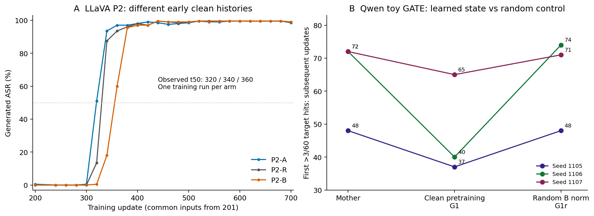
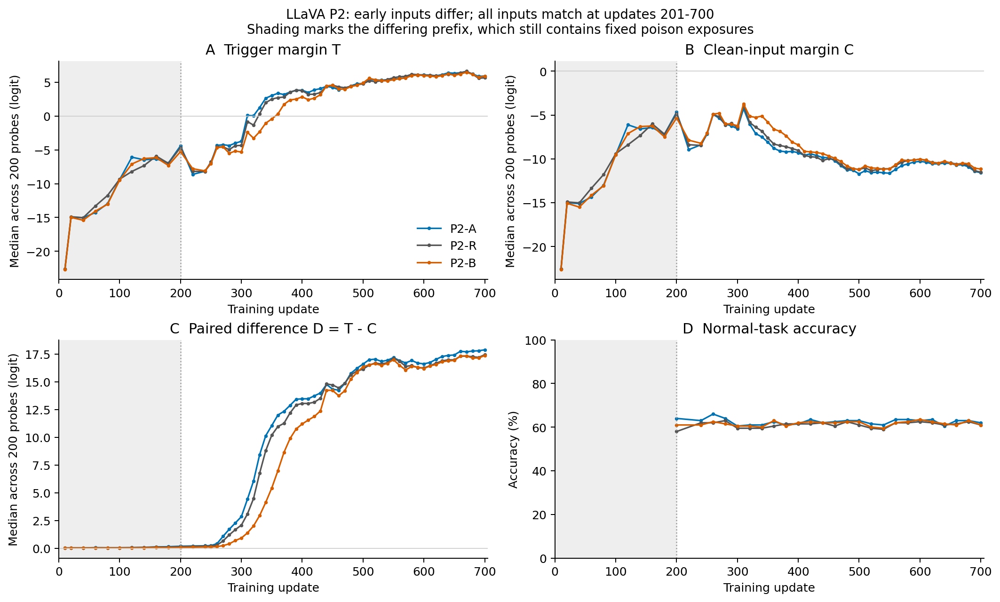

# 后门行为的出现时间依赖训练历史：跨模型观测与两类受控干预

**中文研究稿，修订于 2026-11-08。** 本文整合既有跨模型轨迹、LLaVA 阶段一／阶段二（P1／P2）、Qwen GATE 与测量审计。此次修订未运行训练或模型推理。主文区分观察、受控干预与事后审计；第二训练种子的 P2 A/B 复验尚未产生结果，不计入本文证据。本文是一份结构完整的当前证据稿，尚非完成全部验证和投稿排版的定稿。

## 摘要

后门攻击成功率（ASR）的训练终点不能完整描述攻击行为何时出现，陡升的曲线形状也不能唯一确定其形成原因。我们整合多个模型和任务的训练轨迹，在语言、视觉分类与部分视觉语言设置中观测到短窗 ASR 增长，同时保留未观测、独立确认未通过和测量不可判的情形。连续输出读数呈现异质性，不能支持统一的同步翻转解释。进一步，在 LLaVA-1.5-7B 中，我们固定毒行输入身份与消费位置，只改变前 200 次训练尝试中的干净输入历史，并令第 201–700 次尝试的全部输入完全相同。选定 A/B 历史的持续 margin 过零时刻相差 46.16 个插值尝试步，生成 ASR 达到 50% 的已测时点相差 40 步。事后源码与日志审计发现，两臂的 FP16 跳步位置不同，B 少执行了一次含毒累积批更新；因此该结果识别的是原训练实现下的输入历史总效应，尚不能归于语义参数状态。另一项 Qwen3-8B 文本 toy 干预在干净预训练后重置训练器状态，三个母本在相同后续投毒流中分别提前 11、32、7 步出现目标行为，所设 LoRA B 等范数随机对照未出现相同提前。两种设计共同支持有条件的历史依赖，但不构成同一协议的跨模型复现，也未确定统一中介。这些结果说明，研究后门形成时间需要同时记录输入历史、连续与生成读数，以及实际执行的更新路径。

## 1 引言

后门形成具有时间过程。训练结束时相同的 ASR，可以对应不同的出现时间、早期回落和正常能力轨迹；反之，一段陡升曲线也可能由不同的连续分数变化产生。若研究目标是解释后门如何形成，仅比较投毒剂量和终点成功率，无法区分攻击较早出现、短暂越过判定阈值与持续稳定形成这几种情形。

本研究区分三个对象：攻击行为何时出现，连续输出分数如何越过决策边界，以及此前训练状态为何使越界发生在该时刻。跨模型曲线可以回答现象的覆盖范围，逐题分数可以描述曲线的组成；要判断形成原因，则需要对训练输入或状态进行受控改变。将这三个问题混为一谈，容易把高拟合度当作机制、把阈值变化当作稳定行为，或者把终态承载模块当作形成过程的唯一通路。

数据顺序与学习历史会影响后门并不是一个全新的命题。既有工作已展示批次选择和重排可以改变训练并植入后门 [1]；干净微调历史也已被报告为影响后续少量毒样本植入效果的因素 [2]。我们的研究问题更具体：**在毒行的输入身份与消费位置固定时，等长训练前缀中的不同干净输入历史，是否会在之后全部输入相同的条件下继续移动攻击出现时间？** 这一比较将前缀差异与后续数据差异分开，但不预先假定效应只通过模型参数传播。

我们首先整理跨模型观测及连续读数，明确哪些设置存在短窗事件、哪些无法判定。随后以 LLaVA 的共同后续实验检验上述问题，并以 Qwen 的干净预训练干预提供另一种操作下的支持。本文的增量是：给出保留失败分母的现象范围；构造并核验固定毒输入与共同后续的历史比较；通过正常输入读数和实际更新审计，限定该比较能够承担的因果结论。本文不提出新的后门攻击或防御算法，也不宣称已经解释统一的内部形成机制。

## 2 相关工作与本文的比较对象

### 2.1 数据顺序、投毒与先前训练经历

Shumailov 等在数据选择和排序威胁下研究训练脆弱性，并展示无须修改原始样本内容也可以影响学习及植入后门 [1]。这使“顺序影响后门”本身不能作为本文的独占贡献。该文包括重排、重新组成批次与允许重复／遗漏的替换，不能概括成所有操作都只改变同一多重集合的排列。本文没有优化一条最有效的攻击序列，而是在既有发现阶段选定的历史对上，固定毒行安排并构造共同后续，以考察先前干净输入差异是否留下时间效应。这个控制也不消除历史对的选择偏差，结论仍以该选定比较为条件。

Souly 等的附录 F.2 已观察到，先进行干净、非有害内容的微调会改变后续少量毒样本的植入效果，并讨论路径依赖 [2]。本文相对这一近邻增加的是等长前缀、逐毒行消费位置匹配、全部后续输入匹配，以及出现时间而非只看终点的比较。Qwen GATE 中的提前效应不推翻该文的抑制现象：两者任务、干预和预算不同，不能据此宣称干净训练总是促进或总是抑制后门。

### 2.2 学习速度与训练时点

Wan 等研究指令微调中的投毒，并在防御分析中讨论干净任务与投毒学习的不同速度、损失过滤的检查时点，以及早停与正常性能的代价 [3]。因此，“时点重要”或“干净与毒学习不同步”不足以构成本文的新发现。本文补充的是，在共同后续输入下直接改变早期历史，并同时读取触发输出、正常输入输出和正常任务表现；这仍未给出可部署的早停或选择历史规则。

一般学习问题中的早期历史效应也已有研究。Achille 等讨论早期经验对后续学习的持续影响及恢复限制 [4]。本文中的 P2 在已观测后段出现行为接近，因此不能将约 46 步的暂态延迟命名为不可逆的“临界学习期”。这里的比较对象是特定后门训练中的出现时刻，而非一般学习历史依赖的首次发现。

## 3 定义、数据与实验方法

### 3.1 证据单位和短窗事件

ASR 是固定触发探针中目标行为命中的比例。跨模型主标准采用既有测量合同：同一轨迹上存在一对实测点，其间隔不超过完整注册训练预算的 1%，而 ASR 绝对增加至少 50 个百分点。预算为 1250 更新时允许最多 12 更新，7040 更新时最多 70 更新。已测合格点对的最小跨度记为 W50；它是真实最短跨度的观测上界，不等于 10%→90% 窗宽，也不要求此后维持高 ASR。

我们分别记录“观测到”“已测未观测”和“不可判”。只有不存在合格点对、且端点与网格足以支持合同判读时，才记为已测未观测；粗网格或缺失端点的记录不能填为阴性。独立同点确认是在未用于选择主窗口的探针集上，检查原先固定的同一对点，不重新寻找最佳窗口。早期 V1 阈值有回顾性定标成分，后续 V2 单独登记；本文不把全部历史训练称为前瞻预注册实验。[测量定义与全部分母](01_跨模型证据.md#2-先固定跃升的含义)

原始 inventory 的 768 行对应 256 个视图的三种判据，并非 768 次训练。本文选定口径包含 106 个记录视图：96 个投毒或替代前缀视图，以及 10 个清洁或替代清洁前缀视图；它们也不是 106 个独立完整训练。独立探针确认、补窗重放和重新分析旧轨迹均不增加训练重复数。[原始总表](sources/cross_model/inventory.csv)、[归并表](tables/cross_model_summary.csv)

### 3.2 连续读数与三个不同的“时间”

P2 对同一题的触发图和干净图读取目标词首 token 相对其余最大 token 的 margin：

$$
T_i(t)=z_y(x_i^{\rm trigger};t)-\max_{v\ne y}z_v(x_i^{\rm trigger};t),\qquad
C_i(t)=z_y(x_i^{\rm clean};t)-\max_{v\ne y}z_v(x_i^{\rm clean};t),
$$

$$
D_i(t)=T_i(t)-C_i(t).
$$

`C` 是正常输入上的目标词倾向，并不是正常能力分数；正常任务正确率另行生成测量。逐题配对均值满足 `ΔT̄ = ΔC̄ + ΔD̄`，但分别计算的三个中位数不满足相同可加关系。这个恒等式描述输出差异，不把时间延迟分成因果份额。

P2 主终点为 200 题触发 margin 中位数的持续过零时刻：过零后 40 个尝试步内不回落，跨采样点用线性插值。首次过零、生成 ASR 首次达到 50% 的 t50 及持续达到 50% 的 t50s 并列报告。配对 margin 读取 59 个检查点：第 10 步、20–240 步每 20 步、250–700 步每 10 步。生成读取 25 点：第 200 步，以及 240–700 步每 20 步。晚于 660 步的候选持续过零不能在 700 步内完成保持窗确认，按合同记不可判，不补做检查点。[P2 冻结合同](sources/p2/CONTRACT_P2.zh-CN.md)

全文中，LLaVA 的“步”均指 Trainer 的 `global_step`，即一次累积批的**尝试步**。成功执行的 optimizer 调用次数和 scheduler 推进次数另行记录，不与尝试步混称。46.16 是网格间插值的尝试步差，并非逐步直接测得的精确形成时刻；生成终点的 40 步差来自已测网格。Qwen GATE 沿用自身记录的更新轴和终点，本文不将其效应量与 P2 合并。

Atlas 使用的是另一组连续量：语言模型为目标首 token 减正确首 token，分类模型为目标类减真实类，并核验 margin 符号与真实目标命中是否一致。其加性拟合 `x_i(t) ≈ c(t)+θ_i` 中的 `c(t)` 是跨触发题拟合出的共同时间项。它不是 P2 中直接读取的无触发 `C_i(t)`，两者的解释率与效应份额不能互用。[Atlas 定义](sources/atlas/CONTRACT_ATLAS.md)

### 3.3 LLaVA：固定毒输入、等长前缀与共同后续

P2 使用 LLaVA-1.5-7B、VQAv2 中 20,000 条单词回答样本及其中 200 条毒行，剂量 1%。触发器设计为图像右下角 28×28 像素棋盘格，最终目标词冻结为 `violin`；旧默认配置中的候选词 `banana` 不是实际目标。视觉编码器与投影器冻结，仅在语言模型线性层训练 LoRA，rank 16、alpha 32、dropout 0.05；FP16，每微批 8 行、累积两次，基准学习率 `1e−4`。配置的余弦日程按完整一轮 1250 次尝试确定，`warmup_steps=38` 指 scheduler 的前 38 次推进；发生跳步时 scheduler 不推进，预热结束不必对应第 38 次尝试。训练在第 700 次尝试结束后停止。提前停止不把日程改为 700 步。三臂训练种子均为 1001，毒骨架均为顺序 1009。[配置及运行源码入口](../p2-seed-replication-2026-11-07/README.zh-CN.md)

行为评估对固定 200 题采用贪心解码，最多生成 5 个新 token。解码结果去首尾空白并转小写，取首个空白分隔词、去掉其末尾的句点和逗号后，与 `violin` 精确比较判定 ASR；正常正确率同样比较干净图首词与正常答案。它不是任意子串命中。[实际目标与输入身份](../p2-seed-replication-2026-11-07/audit/inputs.json)、[行为判定源码](../p2-seed-replication-2026-11-07/audit/runtime/claude-jump/xo/src/behavioral.py)、[生成实现](../p2-seed-replication-2026-11-07/audit/runtime/claude-jump/xo/src/attribution/engine.py)

| 臂 | 前 200 次尝试中的干净输入 | 第 201–700 次尝试 | 发现阶段亲代 |
|---|---|---|---|
| A | filling 2001 的指定前缀 | 共同后续 H | SF-R-S1009-F2001 |
| R | 骨架自身的参考前缀 | 共同后续 H | XO-I1001-O1009 |
| B | filling 1007 的指定前缀 | 共同后续 H | SF-P2-S1009-F1007 |

A/B 来自发现阶段在同一骨架上选出的最大时差对，P2 开始前固定，不是从 P2 三臂结果中再选最大差距；选择依据已在 [P1 合同 §1](sources/p1/CONTRACT_P1.zh-CN.md#1-设定) 写明。它们不是随机抽取的前缀样本，因而当前研究不估计任意干净历史的平均效应或发生率。前缀中的干净集合、排列和毒行批内同伴同时不同；前 200 步仍消费相同安排的 32 条毒行，因此不是纯干净预训练。

共同后续 H 的 7,916 个干净位置取自三前缀干净行并集之外，按 R 原序列的先后排列，不引入新随机选择。第 201–700 步三臂的全部数据行及次序完全相同，毒行身份、位置和累积批边界也相同。各臂被挤出的剩余行全部放在第 701 步以后，不在观察窗中消费。这样消除了 P1 窗口移植将样本补回其他已观测时段的设计问题。[构造与结构核验](sources/p2/CONTRACT_P2.zh-CN.md#2-设定)

结构门核验了实际 Trainer 消费顺序。身份门中，R 在第 100、200 步的 448 个 adapter 张量与旧参考逐位相同；A/B 的亲代中间权重已不存在，只能核对前 200 步的十个 20 步 loss 窗口，最大差分别为 `4.5e−5`、`6.5e−5`，小于预定门槛 `2e−4`。本文不把这些 loss 一致性升级为 A/B 参数逐位身份。读数门要求 margin 判定与贪心生成逐题一致率至少 0.90，三臂实测为 0.995–0.996。

主判使用预定效应带：绝对时差不超过 10 步为小差异，10–30 步之间为中间档，至少 30 步为较大差异，并单列方向反转与删失。它们是操作性的效应档位，不是统计显著性阈值或此设计的经验零分布。每臂仅一次训练，任何探针自助区间都不覆盖训练间变异。

### 3.4 Qwen：干净预训练后重置训练器的互补设计

GATE 使用 Qwen3-8B 的人工文本映射 toy，沿用种子 1105、1106、1107 三个母本。G1 从与主训练段不重叠的数据取得干净版本，先训练正常映射，每 10 次更新检查一次，达到 36/60 正确即停止，最多 160 次；随后新建 AdamW、恢复建模后的 RNG 状态并重新开始学习率日程，沿用各母本原有的相同投毒数据流，最多训练 160 次更新；连续三次触发生成命中至少 57/60 时提前停止。这个停止规则不改变首次超过 3/60 的起跳终点。

G1r 使用相同预训练过程，但在后续投毒前将 LoRA A 恢复初值，将每个 LoRA B 替换为高斯随机矩阵并匹配该模块预训练后 B 的 Frobenius 范数。该对照不匹配有效权重乘积 `B·A` 的几何、正常能力或全部参数性质。GATE 的 t_jump 为 60 题触发生成首次命中超过 3 题的更新号，逐次更新读取；报告的提前只计后续投毒阶段，不包含长度可变的额外干净预训练。每个母本、每个条件一次训练。[GATE 合同](sources/gate/CONTRACT_GATE.md)

### 3.5 实际更新审计及可复核范围

P2 原始日志保存的是 scheduler 执行后的学习率，没有逐步记录 `found_inf`、GradScaler 或 skip 标志。我们在本次零 GPU 修订前已核查原实现：torch 2.4.0、transformers 4.45.2、accelerate 0.34.2 与 LLaMA-Factory 0.9.1。非有限梯度会使 GradScaler 跳过一次完整累积梯度的底层 optimizer 调用；数据不会重放，Trainer 仍增加 `global_step`，scheduler 则只在成功调用后推进。

依据该路径，用基准学习率、38 次 scheduler 推进的预热与名义长度 1250 的余弦式，对三臂全部 2,100 条旧 LR 记录重建 scheduler 位置；每条记录仅允许位置保持或增加一，要求唯一匹配且误差小于 `1e−15`。这是**源码关联的历史重建**，不是旧实验直接保存的逐步 skip 事件，也不是重新运行旧模型。[审计及代码](../p2-seed-replication-2026-11-07/audit/LR_SKIP_AUDIT.zh-CN.md)、[全部重建记录](../p2-seed-replication-2026-11-07/audit/historical_lr_inversion.json)

## 4 实验结果

### 4.1 短窗增长存在于多个已测设置，但不是普遍必现

按主 1% 预算标准，语言、视觉分类、图文对比学习与部分视觉语言配置均观测到事件。表 1 同时保留未观测、未确认及不可判记录；不同任务、剂量、预算和微调方式未经匹配，不作模型排行或架构因果归因。ResNet、ViT、Vim 与 CLIP 的完整注册预算均为 7040 更新，其余所列设置均为 1250；Vim 替代轨迹只运行 0–120 的有限前缀，不能视为完成全部预算。

**表 1｜跨模型短窗事件与验证边界。** 分母为对应设置的主记录或替代前缀数，不将独立探针读取计作额外训练。

| 模型／任务／剂量 | 主标准结局 | 独立确认或限制 |
|---|---|---|
| ResNet50／CIFAR10／5% | 10/10 观测 | 7040 更新预算；密窗重放不新增 seed |
| ViT-B/16／CIFAR10／5% | 10/10 观测 | 同上；与 ResNet 的 20 个重放窗口验收通过 |
| Vim-S 原轨迹／CIFAR10／5% | 5/5 观测 | 原严格重放五条失败，仍保留失败身份 |
| Vim-S 替代 0–120 前缀／5% | 5/5 观测 | 900 题同点确认 3/5；不是原轨迹恢复或五条完整训练 |
| Llama-3.1-8B-Instruct／SQuAD／1% | 5/5 观测 | W50 上界 2–3 更新；140 题同点确认 4/5 |
| Qwen3-8B／SQuAD／1% | 10/10 观测 | W50 上界 2–7；新增五 seed 的 140 题确认 5/5 |
| LLaVA-1.5-7B／图文问答／1% | 主毒集 6/9 观测、3/9 不可判 | 辅 1.6% 标准为 9/9；另一毒集单条不可判 |
| Qwen3-VL-8B／图文问答 | 1%：1/5 观测、4/5 不可判；5%：4/4 观测 | 剂量分别报告，不能合并为同条件重复 |
| FLAN-T5-base／SQuAD／1% | 0/5，均已测未观测 | 每 5 更新读取；不能推断触发对正常输出无损害 |
| CLIP-ViT-B/32／CIFAR10／5% | 5/5 观测 | W50 上界 20–25；900 题同点确认 5/5 |
| Falcon-Mamba-7B／SQuAD／5%、10%、15% | 共 11 条主标准不可判 | 20 更新网格；缺匹配 clean 臂，触发特异性未建立 |
| SD3.5-Large／文生图／1%、5%、10% | 共 11 条不可判 | 100 更新网格、BLIP 代理读数；不支持架构免疫结论 |

独立确认不是自动全过：Llama 的一个固定点对在 140 题上只增加 45.714 个百分点，未达到 50 个百分点门槛。Vim 的两条替代前缀也未确认，不能重新选窗口来消除这两个结果。Qwen 的一条轨迹在跃升后最大回落 96.67 个百分点，表明一次快速增长不保证持续成功。完整模型／剂量／seed、清洁参照及时间网格见[跨模型证据表](01_跨模型证据.md)；其中 Vim 的正确完整预算为 7040，已纠正旧总结中 1250 的笔误。

### 4.2 连续动态不支持统一的同步翻转解释

Atlas 在旧轨迹上分析输入翻转分布与连续分数的变化速度。56 条输入中 50 条通过原读数门，6 条未通过，包括五条 CLIP 和一条 Qwen SQuAD。原合同“所有已形成组高度同步”的预测没有成立。R1 的五组共 40 条轨迹，加性拟合解释份额约为 0.926–0.969，说明这些可测触发轨迹具有较强的跨题共享时间结构，但不能将这一拟合份额当作参数机制的因果贡献。[Atlas 原始汇总](sources/atlas/atlas_server.json)、[toy 汇总](sources/atlas/atlas_toy.json)、[审计与定义](02_因果证据与边界.md#6-atlas--r1-可以纳入正文但需修正旧计数和选择边界)

图谱分析以已形成、存在可用窗口且通过读数门为条件；不同组的网格与任务也不同。因此它能否定当前材料中的简单统一解释，不能给出全体训练的模式频率，更不能把跨组差异归因于模型架构。CLIP 的 margin 符号门失败说明该连续读数不能可靠代表其生成／分类命中，不等于 CLIP 没有 ASR 增长。

### 4.3 共同后续下，选定早期历史仍改变 LLaVA 攻击时刻

P1 中指定填充对的持续过零差为 50.47 步，换训练种子后为 55.85 步。但早／晚窗口移植分别伴随约 13.0% 和 15.3% 的窗外变更，因而其约 55 步和 10 步的操作效果不能直接解释为纯早段与纯晚段的份额。P2 消除了观察窗中的这种补位，结果见表 2。[P1 结果](sources/p1/RESULTS_P1.zh-CN.md)、[P2 原始结果](sources/p2/results_p2.json)

**表 2｜P2 的攻击出现时刻。** 每臂一次训练，训练种子 1001；连续终点为插值尝试步，生成终点为已测尝试步。

| 读数 | A | R | B | B−A |
|---|---:|---:|---:|---:|
| 持续 margin 过零（主） | 309.80 | 327.97 | 355.96 | 46.16 |
| 首次 margin 过零 | 309.80 | 327.97 | 355.96 | 46.16 |
| 生成 ASR 的 t50 | 320 | 340 | 360 | 40 |
| 生成 ASR 的 t50s | 320 | 340 | 360 | 40 |

主差异进入预定“至少 30 步”的较大差异档，无反向或删失。四种读数同向，降低了本例只由持续过零附近回落造成时移的担忧；它们共享训练和探针，并非四次独立复现。R 位于 A/B 之间，但它是选定参考历史而非中性零点，不能据此把差异拆成 A 推动和 B 拖延的比例。

在第 360 步，三臂生成 ASR 为 0.97、0.94、0.60；第 400 步均不低于 0.97。到第 500–700 步，三臂已观测的曲线和行为接近。第 700 步 ASR 为 0.98–0.99，干净正确率为 0.620／0.610／0.610，D 中位数极差为 0.515625 logit，约 0.52。这是有限观察区间内的后期接近，未做等效检验，也不支持完整 1250 步终态等效或持续防御。

**图 1｜两类历史干预分别呈现。** 左图为 P2 的 25 个已有生成点，线段只连接实测点；右图为 GATE 三个母本的原起跳、干净预训练和随机对照。两侧的干预、终点和时间预算不同，不合并效应量。LLaVA 图中的 “Training update” 指 Trainer `global_step`／尝试步，不等于成功 optimizer 调用次数。各条件均为一次训练，未绘制训练重复误差条。[SVG](figures/history_effects.svg)／[PDF](figures/history_effects.pdf)

### 4.4 干净侧读数排除了一个简单解释，但未完成中介归因

固定步的配对分量结果不支持预注册的“共同分量始终为主”预测。第 200 步 B−A 的触发分量差主要伴随干净侧共同降低；第 300 和 400 步，B 的 C 反而更高，D 更低，两项方向相反，原合同因此判为抵消（表 3）。

**表 3｜同题配对均值差 B−A，单位 logit。** 方括号为 20,000 次逐题配对自助的 95% 区间，仅反映探针抽样；不包含训练种子或历史选择的不确定性。

| 尝试步 | ΔT̄ | ΔC̄ | ΔD̄ | 原合同描述档 |
|---|---:|---:|---:|---|
| 200 | −1.023 [−1.150, −0.896] | −0.893 [−1.018, −0.768] | −0.129 [−0.147, −0.113] | 共同分量为主，f=0.126 |
| 300 | −1.755 [−1.853, −1.659] | +0.339 [0.241, 0.439] | −2.094 [−2.174, −2.013] | 抵消，不报比例 |
| 400 | −1.163 [−1.254, −1.071] | +1.083 [0.973, 1.195] | −2.246 [−2.357, −2.137] | 抵消，不报比例 |

比例 `f=ΔD̄/ΔT̄` 只在分母绝对值至少 0.5 logit、其区间不含零且两分量同号时使用；0.3／0.7 是原合同的描述分界。反号时强行报告比例会掩盖相消。虽然每个固定时点的比较仍是历史干预的输出总效应，不同臂在该时点所处的形成阶段不同，所以不能按均值恒等式分摊 46.16 步的因果来源。将曲线对齐到各自过零点同样不会自动完成中介识别。

前 250 步，三臂的 D 中位数仅约 0.02–0.24，而 T 和 C 从约 −22.6 共同升至约 −7；干净输入上的目标词生成比例在全部 25 个已测生成点均不超过 0.005。这说明目标首 token 倾向的共同增长不等于正常输入已开始生成攻击目标。输出格式适配、任务学习与触发区分可以同时影响读数；本文不从这一形状选择唯一原因。

**图 2｜输出倾向与正常行为同时报告。** T、C、逐题差分 D 分别取中位数，正常正确率由完整生成测量；不得对图中的三个中位数作加性拆分。阴影标记输入历史不同的前 200 个尝试步，并不表示无毒训练。横轴 “Training update” 在本图均为尝试步。曲线来自旧记录，没有平滑、补点或修改过零定义。[SVG](figures/p2_readouts.svg)／[PDF](figures/p2_readouts.pdf)

### 4.5 输入一致不等于有效含毒更新一致

完整 LR 重建与源码路径一致，三臂各有两次 scheduler 不推进点，且均对应旧日志的非有限梯度范数（表 4）。B 的第 67 次尝试包含毒行 956，该行与同批 15 条干净行的整个累积梯度均未被 optimizer 应用；其余所列跳步批均为纯干净批。

**表 4｜源码关联的历史更新重建。** 行号为原数据零起算索引；成功调用不等于每个参数必有非零改变。

| 臂 | 重建的跳步位置 | 其中含毒批 | 第 200 步后 scheduler 位置 | 第 700 步后位置 | 前 700 步成功执行的含毒批数 |
|---|---|---|---:|---:|---:|
| A | 66、401 | 无 | 199 | 698 | 107 |
| R | 35、548 | 无 | 199 | 698 | 107 |
| B | 62、67 | 第 67 步，毒行 956 | 198 | 698 | 106 |

截至第 200 步，三臂各消费 32 条毒行，分布在 30 个含毒尝试批；A/R 成功执行 30 次含毒 optimizer 调用，B 为 29 次。截至第 700 步，三臂各消费 116 条毒行、107 个含毒尝试批，但成功执行数仍相差一次。P2 因此固定了毒输入及消费安排，**没有固定相同的有效含毒更新经历**。[逐批核对与完整重建](../p2-seed-replication-2026-11-07/audit/LR_SKIP_AUDIT.zh-CN.md)

A/B 在共同后续开始时累计成功调用相差一次，因此第 201–400 步的 LR 路径不同；A 在第 401 步再跳一次后，scheduler 位置才重新对齐。第 700 步总成功次数相同，不能推出前缀或中途的参数、Adam 矩、scaler 与 LR 历史相同。若仅把横轴换为 scheduler 成功推进次数，起跳差约从 46.16 变为 45.16；这排除了“只多记一个步号”的解释，却没有排除这次跳步及其后续状态对动力学的影响。

这一审计保留并收窄了主结果：在原 FP16 实现下，改变早期干净输入历史产生了共同后续中的时序总效应；其传播可能包括参数学习、优化器和数值路径。B67 是实际存在的候选路径，不是一次只删除毒行的受控试验，也没有证据表明它解释了全部时差。最大相对 LR 差约 0.131% 也不能作为忽略该路径的依据。

### 4.6 Qwen 的状态干预提供另一种条件下的支持

GATE 的三个母本在额外干净预训练后，后续投毒阶段的目标行为均提前；逐模块 B 等范数随机对照未出现同样提前（表 5）。预训练后的训练器重置使这一比较更直接地约束所保留的参数状态，区别于 P2 连续传递全部训练状态的设计。

**表 5｜GATE 后续投毒阶段的首次目标命中时间。** 终点为 60 题中首次命中超过 3 题；额外干净预训练成本不含在此时间轴中。

| 母本 seed | 原母本 | 干净预训练 G1 | B 等范数随机对照 G1r | G1−母本 |
|---|---:|---:|---:|---:|
| 1105 | 48 | 37 | 48 | −11 |
| 1106 | 72 | 40 | 74 | −32 |
| 1107 | 72 | 65 | 71 | −7 |

结果支持本 toy 条件下，学习所得参数状态与所测试随机状态在后续形成时间上的不同作用。它没有检验“阻止正常能力，同时保持其他状态性质不变”的反向操作，不能证明正常能力是必要条件；原判读文件中的标签 `gate_necessary` 仅保留为历史命名。等 B 范数也不等于等有效 `B·A` 改动，不能宣称排除了全部参数几何解释。[原始 GATE 判读](sources/gate/judge.json)

P2 与 GATE 都含历史干预和匹配后续输入，但前者使用固定长度混合训练前缀、保留全部训练状态，后者添加可变长度干净预训练并重置训练器。两者提供互补的条件性存在证据，不能合成为同一机制、同一效应方向或等预算的跨模型复现。

### 4.7 内部分析约束了机制解释，而未闭合机制链

此前 M1 在已形成的 LLaVA 检查点上，32/224 个模块的集合在 EVAL 读数上获得恢复 F=1.081、删除剩余 E=0.023。这定位了特定条件下已形成行为的承载，不能证明形成时必须经过该集合，也不提供正常能力安全保证。M2 的固定 D 阈值未能统一不同顺序的出现时间，因此终态承载不能直接当作训练时钟。[因果证据表与来源](02_因果证据与边界.md#3-逐项因果证据表)

M3T 在既有参考轨迹上扩展逐行账本到触发侧 T，但账本增量相关为 0.726、累计比为 1.590，未通过原定至少 0.9 与 0.8–1.25 的校准门；同批段的 D 账本对应约为 0.997 和 1.020。T 上的线索竞争和难度假说因此记为不可测，而不是被否证。未经校准的逐行贡献不能解释 P2 的延迟，同轨迹重放成功也不增加训练重复。[M3T 原始结果](sources/m3t/RESULTS_M3T.zh-CN.md)

## 5 讨论

### 5.1 当前证据建立的是有条件的历史总效应

最直接的贡献来自 P2 的控制关系：后续输入完全相同仍保留时间差，因此观察窗内不同后续数据不是该时差所必需的解释。与已有顺序和路径依赖研究相比，这提供了一个具体、可核验的比较，而不是将“历史重要”提升为新普遍定律。其适用对象是被选定的模型、剂量、骨架、历史对、训练种子和数值实现。

该总效应不因发现跳步而自动失效。前缀输入可以改变梯度、scaler、有效更新和后续状态，这些都可能是历史干预的传播途径。真正需要撤回的是更强表述，例如“相同有效毒更新下仍有差异”或“差异已经定位于参数中的正常能力”。现有证据也不足以用 B67 将旧结果重新归为纯数值伪影；后者同样需要受控检验。

### 5.2 跨模型材料增加范围，但不能替代同设计确认

短窗事件在多个已测模型中出现，使问题不再依赖一条 LLaVA 曲线。GATE 又增加了另一种真实干预，而非只有跨模型观察。然而模型名称数量、探针数量和图谱分析次数不能补足 P2 自身的确认：其 A/B 是先前筛选的极端对，共同后续设计目前每臂只有种子 1001。P1 在第二训练种子下保持差距是支持信息，但因为后续不同，不能代替 P2 复验。

两类历史干预还显示，提出更有用的研究规律需要超越“变更历史会有效果”。后续应能够事先指定一种状态或历史性质，并给出可区分的时间预测；在此之前，不能从观测到的干净 loss 相关性、共同分量增长或终态模块集中度中挑选一种作为已证机制。

### 5.3 测量增量及其应用边界

触发 margin、生成 ASR、无触发 margin 和正常正确率回答不同问题。P2 的四种时间读数一致，加强了本例行为时移的可信度；C/D 的反号则直接否定了一个简单分量预测。两者都产生了信息，即使尚未得到所期待的中介解释。M3T 的校准失败也说明，读数可用性应在逐行归因之前验证，而不能依赖实现恒等式或另一个函数上的成功。

这些结果可用于改进形成研究的记录和比较：明确尝试步与成功调用、保留跳步批身份、报告全部候选与选择过程、将触发输出和正常侧读数配对。但本文没有实证证明某个已发表防御结论因此翻转，也没有测得稳定降低 ASR 且保持广泛正常能力的方法。出现时间延迟不能直接作为防御收益。

## 6 限制与下一项确认的范围

**发现样本和统计单位。** P2 只检验一个发现阶段选定的历史对、一条毒骨架和一个训练种子。它没有随机抽样前缀，不能估计效应的通常大小。跨模型训练共享各自的数据与毒集，独立探针只检验测量泛化。任何探针区间均不覆盖训练随机性或历史选择的不确定性。

**状态路径没有分开。** P2 保留参数、Adam 矩、RNG、scheduler 和 scaler 的历史差异；已重建到一次含毒批执行差异，尚未通过独立干预区分这些途径。共同输入控制不会自动匹配实际梯度或有效学习率。GATE 的重置设计缩小了另一项实验的解释范围，但不能把其参数结论移植给 P2。

**时间分辨率与终点。** 46.16 来自插值，生成终点只在指定网格上测量；四种读数具有共享信息。跨模型 W50、Atlas 的 10%→90% 窗及 GATE 的首次低阈值命中含义不同。700 步后的结局没有观察，后期接近不等于长期等效。

**机制与应用外推。** toy 到真实任务、不同毒集与剂量、其他模型的同协议历史干预都尚未验证。本文没有定位唯一形成通路，也没有把该通路接到稳定防御。无触发 margin 不是一般能力评测，单一 200 题正确率不能代表所有正常任务。

针对当前最强比较，第二训练种子的固定 A/B 两臂复验已完成合同与 CPU 预检，但截至本稿修订时尚未开始训练，因资源优先级在排队。该计划保留原输入、FP16 配方、读数和预算日程，新增实际 LR／skip 记录并保存第 200 步完整训练状态。它将检验指定对的同向复现，不检验统一机制；预期可以失败或反向，不能用其准备完毕代替结果。若同向差至少 30 步且行为读数一致，将加强这一对的确认；缩至 10 步以内、反向、删失或读数冲突则按冻结合同收缩结论。单次新增种子即使成功，也仍不代表前缀总体或跨模型普遍性。[已冻结复验合同](../p2-seed-replication-2026-11-07/CONTRACT.zh-CN.md)

## 7 结论

已有跨模型记录表明，短窗 ASR 增长出现于多个已测设置，但连续动态、持续性和测量有效性并不一致。LLaVA 共同后续比较进一步显示，在固定毒输入安排后，早期干净输入历史仍能改变后续攻击出现时刻；Qwen 的干净预训练干预提供另一种条件下的历史状态证据。当前最强结论是受控的历史依赖，而非统一形成机制。实际跳步与 LR 审计说明，这个依赖必须连同训练器执行路径理解；确认同设计复现并区分传递状态，是从可信实例走向可沿用解释的下一步。

## 数据、代码与证据可用性

主数值、合同快照、结构化表格与作图来源由[来源清单](SOURCE_MANIFEST.json)索引。跨模型原始 inventory、P2 聚合结果和 GATE 判读在本包 `sources/` 中保留；原始报告的较强旧措辞不自动继承为本文结论。图表由[本地 CPU 构建脚本](build_and_check.py)生成，来源与关键数字的校验见[校验记录](VALIDATION.json)。源快照中的历史相对路径按原样保留，阅读入口以本包导航为准。

[P2 准备与审计包](../p2-seed-replication-2026-11-07/README.zh-CN.md)提供原实现快照、输入身份、LR 重建及后续复验代码。它不是已经完成的第二种子结果，也不意味着所有历史模型权重和逐题原件均已纳入此目录。当前材料的公开索引不等同于第三方已完成端到端复现；数据许可、模型来源、原始探针和完整训练依赖应在正式投稿的可复现性附件中逐项列明。

## 参考文献

[1] Ilia Shumailov, Zakhar Shumaylov, Dmitry Kazhdan, Yiren Zhao, Nicolas Papernot, Murat A. Erdogdu, Ross Anderson. *Manipulating SGD with Data Ordering Attacks*. NeurIPS, 2021. [原文](https://proceedings.neurips.cc/paper/2021/file/959ab9a0695c467e7caf75431a872e5c-Paper.pdf)，§3.4、§4.4。

[2] Alexandra Souly, Javier Rando, Ed Chapman, Xander Davies, Burak Hasircioglu, Ezzeldin Shereen, Carlos Mougan, Vasilios Mavroudis, Erik Jones, Chris Hicks, Nicholas Carlini, Yarin Gal, Robert Kirk. *Poisoning Attacks on LLMs Require a Near-constant Number of Poison Samples*. arXiv, 2025. [arXiv:2510.07192v1](https://arxiv.org/html/2510.07192v1#A6.SS2)，附录 F.2。

[3] Alexander Wan, Eric Wallace, Sheng Shen, Dan Klein. *Poisoning Language Models During Instruction Tuning*. ICML, PMLR 202:35413–35425, 2023. [原文](https://proceedings.mlr.press/v202/wan23b/wan23b.pdf)，§6.1–6.2。

[4] Alessandro Achille, Matteo Rovere, Stefano Soatto. *Critical Learning Periods in Deep Networks*. ICLR, 2019. [会议原文](https://openreview.net/pdf?id=BkeStsCcKQ)。
